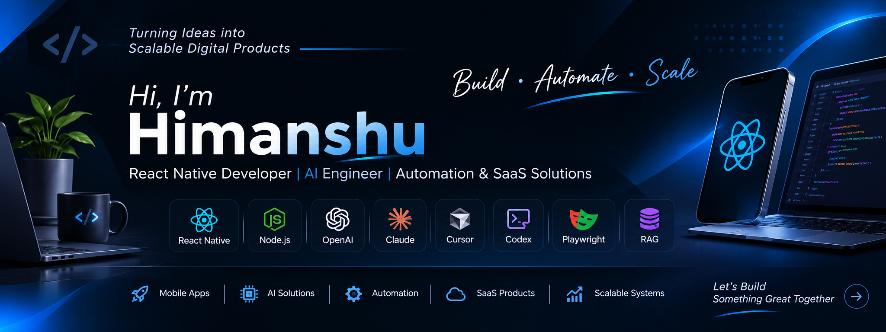

### React Native Developer | AI Engineer | Automation & SaaS Solutions

Building scalable mobile applications, intelligent AI solutions, and automated digital products.

---

## About Me

I'm **Himanshu**, a software developer with **6+ years of experience** specializing in React Native, mobile application development, AI engineering, automation, and SaaS solutions.

I help transform ideas into production-ready digital products by combining modern engineering practices, scalable architecture, and AI-powered technologies.

My experience includes building cross-platform applications, developing intelligent AI systems, implementing RAG pipelines, automating workflows, and engineering scalable backend solutions.

I focus on building products that are reliable, maintainable, performant, and ready for long-term growth.

## Technical Expertise

### Mobile & Frontend Development

### Backend & API Engineering

### AI & Intelligent Systems

- OpenAI API and ChatGPT integrations
- Claude AI and LLM integrations
- Retrieval-Augmented Generation (RAG)
- AI Chatbots and Intelligent Assistants
- Vector Search and Knowledge Retrieval
- AI-powered Application Development
- Prompt Engineering and AI Workflows

### AI-Assisted Development Tools

Working with modern AI coding tools to accelerate development, improve engineering workflows, and build software more efficiently.

### Automation & Workflow Engineering

- Browser Automation
- Workflow Automation
- Playwright Automation
- Automated Testing
- API and Process Automation
- AI-powered Workflow Automation
- Intelligent Task Automation

### Development Tools

---

## What I Build

<table>
<tr>
<td width="50%">

### Mobile Applications

Cross-platform iOS and Android applications using React Native, with a focus on performance, scalability, and user experience.

</td>
<td width="50%">

### AI-Powered Applications

Intelligent applications integrating OpenAI, Claude, LLMs, RAG pipelines, and conversational AI.

</td>
</tr>
<tr>
<td width="50%">

### SaaS Platforms

Scalable products with authentication, subscriptions, payment integrations, and robust backend architecture.

</td>
<td width="50%">

### Automation Systems

Automated workflows, browser automation, Playwright solutions, and intelligent business process automation.

</td>
</tr>
<tr>
<td width="50%">

### RAG & Knowledge Systems

AI-powered knowledge retrieval systems that connect LLMs with custom data sources and contextual information.

</td>
<td width="50%">

### Backend Engineering

Reliable backend services, REST APIs, GraphQL integrations, and scalable server-side systems.

</td>
</tr>
</table>

---

## Engineering Principles

| Principle | Approach |
|---|---|
| Architecture | Clean, modular, scalable architecture |
| Performance | Fast and responsive applications |
| Code Quality | Maintainable and reusable code |
| AI Integration | Practical and intelligent AI solutions |
| Automation | Efficient and reliable workflows |
| Security | Secure and reliable implementations |
| Scalability | Systems designed for future growth |

---

## Industries & Experience

`Fitness & Healthcare` · `Social Networking` · `SaaS` · `Artificial Intelligence` · `Automation` · `Startup Products`

---

## Let's Connect

I'm always interested in connecting with developers, founders, startups, and businesses working on innovative digital products.

Whether you're building a mobile application, developing an AI-powered platform, implementing RAG, or automating business workflows, let's connect.

### Let's Build Something Impactful

  

**Himanshu**  
Software Developer | React Native | AI | Automation

